# pulse_transitions
Pulse and transition metrics for sampled waveforms, following IEEE Std 181-2003: state levels, transition instants,
rise and fall times, slew rate, overshoot, undershoot, settling time, pulse width, period and duty cycle. A
`matlab` module mirrors MATLAB's [Pulse and Transition Metrics](https://www.mathworks.com/help/signal/pulse-and-transition-metrics.html)
functions. numpy is the only runtime dependency.

## Example Use Case
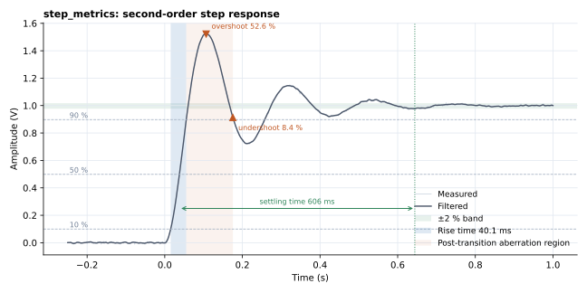

For the full example see [examples/step_metrics.py](examples/step_metrics.py); there is one example per feature
under [Examples](#examples).

Every function takes the waveform `y` first and everything else by keyword. Give the time axis as `x=` (any
spacing), as a sample rate `fs=`, or leave both out to use sample indices. Reference levels are percentages
`(lower, mid, upper)` of the amplitude, default `(10, 50, 90)`.

```python
import numpy as np
import pulse_transitions as pt

t = np.linspace(0, 10e-6, 100_000)
y = np.clip((t % 2e-6 - 0.4e-6) / 40e-9, 0, 1) - np.clip((t % 2e-6 - 1.2e-6) / 40e-9, 0, 1)

levels = pt.state_levels(y, x=t)                     # histogram mode: levels.low, levels.high
for tr in pt.transitions(y, x=t, levels=levels.levels):
    print(tr.polarity.name, tr.mid_instant, tr.duration, tr.slew_rate)

step = pt.step_metrics(y, x=t, bounds=(0, 1e-6))     # exactly one transition: the first rise
print(step.post_overshoot.percent, step.settling_time)

for p in pt.pulses(y, x=t):
    print(p.width, p.period, p.duty_cycle)
```

| Function | Returns |
| --- | --- |
| `state_levels(y, method="mode")` | `StateLevels(low, high)`; methods `mode`, `mean`, `peak`, `endpoints` |
| `reference_levels(levels, reference)` | absolute `(lower, mid, upper)` levels |
| `transitions(y, ...)` | every `Transition` in time order: polarity, lower/mid/upper instants, `duration`, `slew_rate` |
| `transition_metrics(y, ...)` | `TransitionMetrics` per transition: pre/post overshoot and undershoot, settling time |
| `step_metrics(y, ...)` | `TransitionMetrics` of the one transition in the data (use `bounds=` to pick it) |
| `pulses(y, ..., polarity=Polarity.RISING)` | `Pulse` per pulse: width, period, separation, duty cycle |
| `measure_edge(y, around=...)` | one edge of a multi-level trace, measured between its own levels |
| `flatness(y, bounds=...)` | standard deviation of a window, normalised to the final level |

`bounds=(start, end)` restricts any analysis to `start <= x <= end`; detected levels then come from that window.
Noise near a reference level doesn't bias the instants: each one is the median crossing of its level. The mid
instant can instead be the first crossing (`mid_method="first"`), or where a least-squares line through the edge
crosses the mid level (`mid_method="fit"`). On a noisy, near-linear edge the fit is several times more precise
than the median; on a curved edge (an RC step, say) it is biased, so it isn't the default.

Overshoot and undershoot are the actual excursion past the state level, however small, measured in an aberration
region that starts where the waveform first reaches its new level and runs `aberration_factor` (default 3) edge
durations. Noise peaks are excursions too, so filter noisy data first; `state_tolerance` (2 %) sets the settling band.

## Measuring one edge of a signal that has several

A trace that steps through several levels (a TDR trace has a new level after every discontinuity) has no single
pair of levels. `measure_edge` takes the edge nearest a place you give, rising or falling, and measures it between
the flat parts either side of it (or levels you pass):

```python
from pulse_transitions import EdgeNotFoundError, measure_edge

x = np.arange(0, 14, 0.01)
y = np.clip((x - 2) / 2, 0, 1) + 2 * np.clip((x - 6) / 2, 0, 1)   # 0 → 1, then 1 → 3

try:
    edge = measure_edge(y, x=x, around=7.0, max_distance=1.0, reference=(20, 50, 80))
except EdgeNotFoundError as error:
    print(error)
else:
    bottom, top = edge.levels                 # (1.0, 3.0)
    print(edge.transition.start, edge.transition.end, edge.duration)
```

`Transition.start` and `Transition.end` are the first and last reference crossings in time order, so a falling
edge crosses its upper level at `start`.

## MATLAB-style functions

`pulse_transitions.matlab` keeps MATLAB's names, positional `(y, t)` arguments and array outputs, and adds no logic
of its own: each value equals the matching call above.

```python
from pulse_transitions import matlab

d, lower, upper, lower_level, upper_level = matlab.risetime(y, x)
```

| Function | Description | Implemented? |
| --- | --- | --- |
| [statelevels](https://www.mathworks.com/help/signal/ref/statelevels.html) | State-level estimation for bilevel waveform with histogram method | ☑️ |
| [midcross](https://www.mathworks.com/help/signal/ref/midcross.html) | Mid-reference level crossing for bilevel waveform | ☑️ |
| [risetime](https://www.mathworks.com/help/signal/ref/risetime.html) | Rise time of positive-going bilevel waveform transitions | ☑️ |
| [falltime](https://www.mathworks.com/help/signal/ref/falltime.html) | Fall time of negative-going bilevel waveform transitions | ☑️ |
| [slewrate](https://www.mathworks.com/help/signal/ref/slewrate.html) | Slew rate of bilevel waveform | ☑️ |
| [overshoot](https://www.mathworks.com/help/signal/ref/overshoot.html) | Overshoot metrics of bilevel waveform transitions | ☑️ |
| [undershoot](https://www.mathworks.com/help/signal/ref/undershoot.html) | Undershoot metrics of bilevel waveform transitions | ☑️ |
| [settlingtime](https://www.mathworks.com/help/signal/ref/settlingtime.html) | Settling time for bilevel waveform | ☑️ |
| [pulsewidth](https://www.mathworks.com/help/signal/ref/pulsewidth.html) | Bilevel waveform pulse width | ☑️ |
| [pulseperiod](https://www.mathworks.com/help/signal/ref/pulseperiod.html) | Period of bilevel pulse | ☑️ |
| [pulsesep](https://www.mathworks.com/help/signal/ref/pulsesep.html) | Separation between bilevel waveform pulses | ☑️ |
| [dutycycle](https://www.mathworks.com/help/signal/ref/dutycycle.html) | Duty cycle of pulse waveform | ☑️ |

The histogram `mode` level is the mean of the samples in the modal bin rather than the bin centre, so clean levels
come out exact. `pulseperiod`, `pulsesep` and `dutycycle` report complete periods only, and `overshoot` and
`undershoot` report the post-transition region, as MATLAB does by default.

## Errors

Every library error is a `PulseTransitionsError`, which is a `ValueError`:

- `InputError`: a bad argument; the message names it.
- `LevelError`: two state levels can't be found (for example, a constant signal).
- `EdgeNotFoundError`: an edge that must exist doesn't; the message says what is missing.

Unknown keyword arguments raise `TypeError` rather than being ignored. `transitions`, `transition_metrics` and
`pulses` return `()` when there is nothing to report; only `step_metrics` and `measure_edge` raise for a missing
edge. Samples where `x` or `y` is NaN are dropped first.

## Upgrading from v0.2

v0.3 is a rewrite and breaks the v0.2 API:

- `y` comes first and `x` is a keyword: `f(x, y)` becomes `f(y, x=x)`. A v0.2-style call raises `TypeError`
  instead of silently swapping the axes.
- `detect_signal_levels` is `state_levels`, `detect_edges` is `transitions`, and `get_edge_metrics` is
  `transition_metrics` (or `step_metrics` for a single step).
- `fractional_thresholds=(0.1, 0.9)` is `reference=(10, 50, 90)`, in percent.
- `Edge` is `Transition`; `measure_edge` returns `EdgeMeasurement` with the `Transition` in `.transition`.
- `EdgeNotFoundError` is no longer an `IndexError`, and `flatness` returns NaN instead of `None`.
- scipy is no longer a dependency, and `CrossingDetectionSettings` is gone: hysteresis between the reference levels
  rejects noise. Filter before measuring if you need to (the example shows how).

## Examples

Each script in `examples/` demonstrates one feature, prints its measurements and saves the figure shown here to
`examples/figures/<script>.svg`.

### `state_levels`: [state_levels.py](examples/state_levels.py)
The four level methods on a ringing pulse train. Overshoot pulls `peak` (and slightly `mean`) away from the settled
levels; `mode`, the default, and `endpoints` find them.

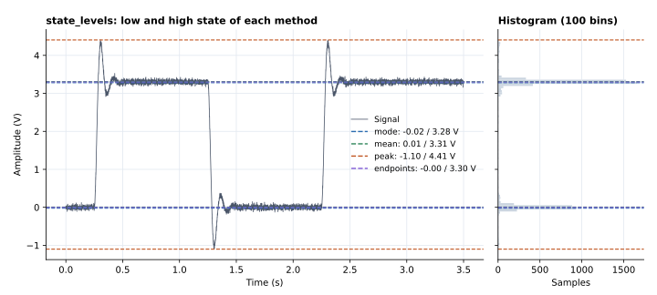

### `reference_levels`: [reference_levels.py](examples/reference_levels.py)
The same edge with 10/50/90 % and 20/50/80 % reference levels, and the rise time each gives.

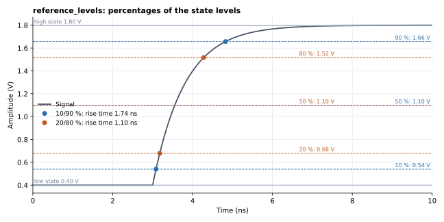

### `transitions`: [transitions.py](examples/transitions.py)
Every edge of a pulse train with its lower, mid and upper instants, duration and slew rate.

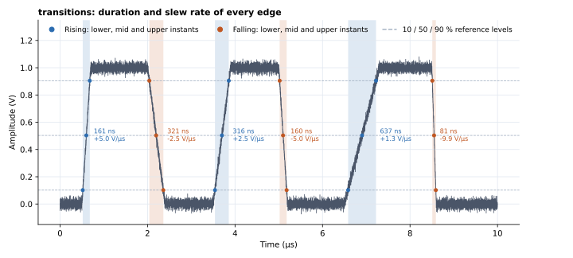

### `transition_metrics`: [transition_metrics.py](examples/transition_metrics.py)
Overshoot and undershoot in each post-transition aberration region, and the settling time into the ±2 % band.

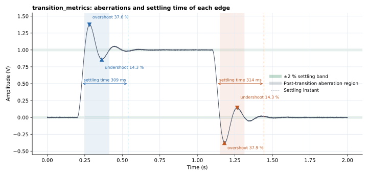

### `step_metrics`: [step_metrics.py](examples/step_metrics.py)
A noisy second-order step response, low-pass filtered, with its rise time, aberrations and settling time: the
figure at the [top of this page](#example-use-case).

### `pulses`: [pulses.py](examples/pulses.py)
Width, separation and period of a PWM signal, and each period's duty cycle. The last pulse has no next rising edge,
so its period and duty cycle are NaN.

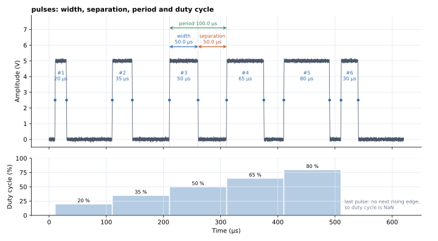

### `measure_edge`: [measure_edge.py](examples/measure_edge.py)
Three edges of a multi-level TDR trace, each found near `around` and measured between the flat levels either side.

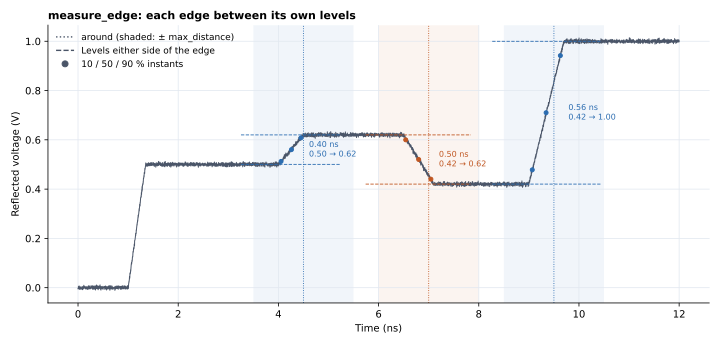

### `flatness`: [flatness.py](examples/flatness.py)
Flatness of a ringing window and a settled one, and over a sliding 100 ms window.

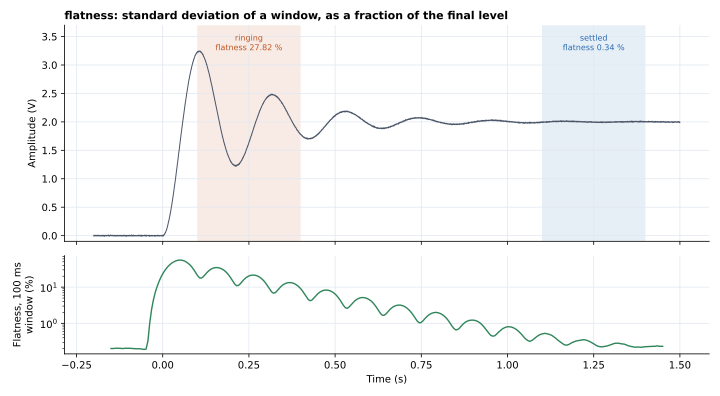

### `mid_method`: [mid_method.py](examples/mid_method.py)
Median, first-crossing and least-squares mid instants on a noisy edge, and their RMS error on linear and RC edges.

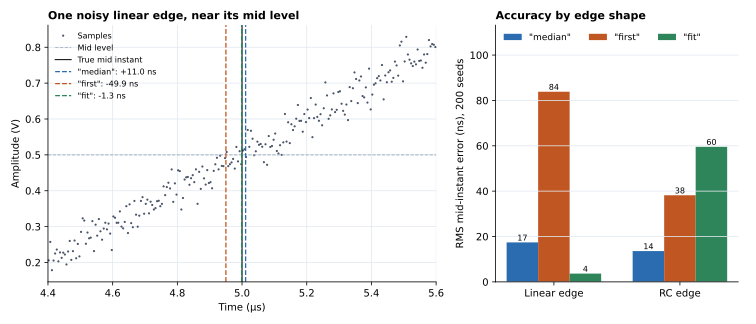

### `matlab` functions: [matlab_facade.py](examples/matlab_facade.py)
`statelevels`, `risetime`, `falltime`, `midcross`, `pulsewidth` and `dutycycle` on a PWM signal.

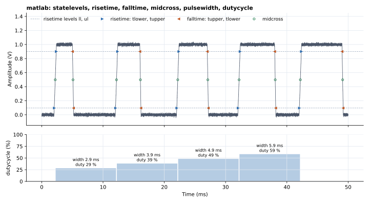

### Accuracy against the closed form

These measure synthesised steps whose metrics have a closed form and compare with it. Most use a second-order step,
`1 - e^(-ζωn t) sin(ωd t + acos ζ) / sqrt(1 - ζ²)`, with the overshoot `100 e^(-πζ / sqrt(1 - ζ²))`, the undershoot
(its first trough, the overshoot squared), and the rise and settling times by root finding on the closed form; the
last two use a first-order step and a slew-limited one.

#### Across damping ratios: [analytic_damping.py](examples/analytic_damping.py)
ζ from 0.1 to 0.95 with 0.5 % RMS noise, low-pass filtered, 30 noise seeds each. Overshoot, undershoot and rise time
match the exact values to within a few hundredths. Settling time follows the closed form's staircase (each step is
where another ringing peak drops inside the ±2 % band) and scatters only where a peak sits right at the band edge.

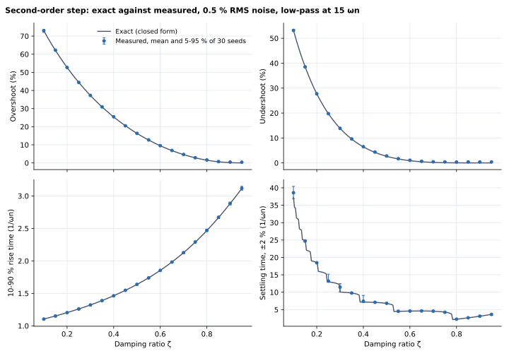

#### As noise grows: [analytic_noise.py](examples/analytic_noise.py)
ζ = 0.5, noise from 0 to 3 % RMS, raw and low-pass filtered. Unfiltered, the overshoot reads high by about twice the
RMS noise, because a noise peak on the ringing counts as excursion; the settling time jumps to the end of the record
once noise peaks reach the ±2 % band, at about 0.5 % RMS. Filtering removes most of both. Rise time is unbiased.

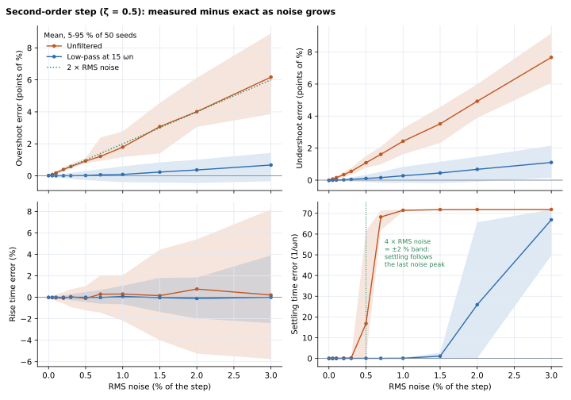

#### As sampling gets coarser: [analytic_sampling.py](examples/analytic_sampling.py)
ζ = 0.5, noiseless, from 50 down to 1.5 samples per rise time at random sample offsets. Interpolated crossings keep
the rise time within 1 % down to about 6 samples per edge; the overshoot is the largest sample, so it reads low once
the peak falls between samples, bounded by the peak half a sample away.

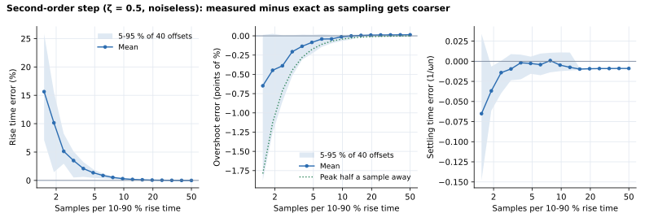

#### As the ADC gets coarser: [analytic_quantization.py](examples/analytic_quantization.py)
ζ = 0.5, noiseless, quantised to 4–16 bits with the step at 80 % of full scale. Each error halves with every added
bit, following half an LSB over the slope at the crossing (one LSB for the overshoot), down to a small floor set by
the level estimate. The settling time needs an LSB well inside the ±2 % band: below about 7 bits it jumps between
ringing peaks.

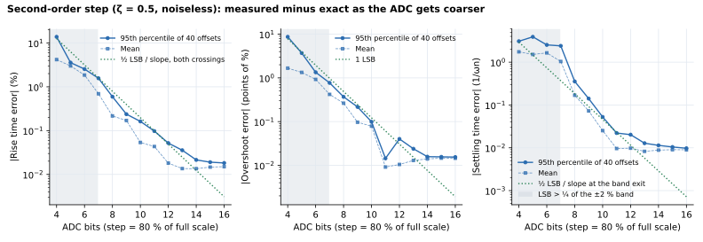

#### First-order (RC) step: [analytic_first_order.py](examples/analytic_first_order.py)
`1 - e^(-t/τ)` crosses level L at `τ ln(1 / (1 - L))`: rise time `τ ln 9`, 20–80 % `τ ln 4`, settling `τ ln 25`.
Noise moves each crossing by the noise over the slope, and an RC edge slows as it goes (0.9/τ at 10 %, 0.1/τ at
90 %, 0.02/τ at the band edge), so the 90 % crossing jitters nine times as much as the 10 % one and the settling
time reads late. Once the noise exceeds the slope times the sample spacing the level is crossed several times and
the median crossing (§C7) jitters less than noise / slope.

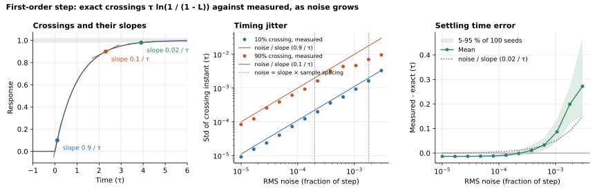

#### Slew-limited step: [slew_limited.py](examples/slew_limited.py)
An amplifier with time constant τ and slew rate S ramps at S until the error is Sτ, then settles exponentially;
`a = V / (Sτ)` takes it from a pure exponential (a < 1) to a ramp (a ≫ 1), with every crossing in closed form. The
ratio of the 20–80 % to the 10–90 % rise time tells them apart without knowing τ or S: `ln 4 / ln 9 = 0.631` for an
exponential, 0.75 for a ramp. A measured edge near 0.75 is slewing, and a smaller step will be faster.

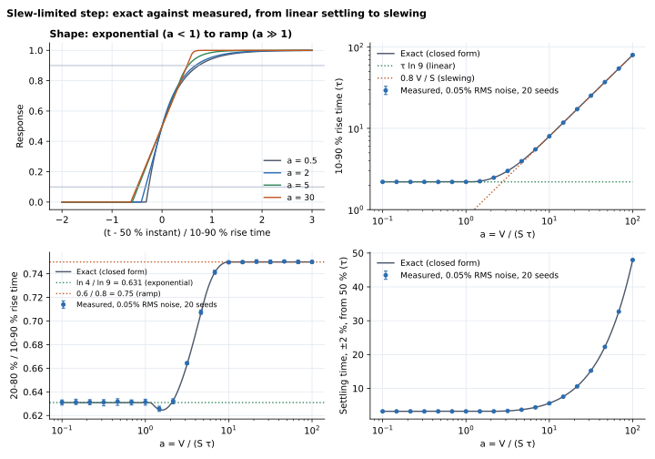

### Measured data

These use real captures from [examples/data](examples/data/README.md).

#### Photoreceiver pulse response: [photoreceiver_pulse.py](examples/photoreceiver_pulse.py)
A 10 MΩ photoreceiver with two photodiodes, A and B, at small and large output swing. Each capture starts
with a one-sample trigger glitch, so the analysis uses `bounds=` to skip it. Both edges overshoot by 0.6–2.8 %; at
large swing photodiode B overshoots most and takes twice as long to settle.

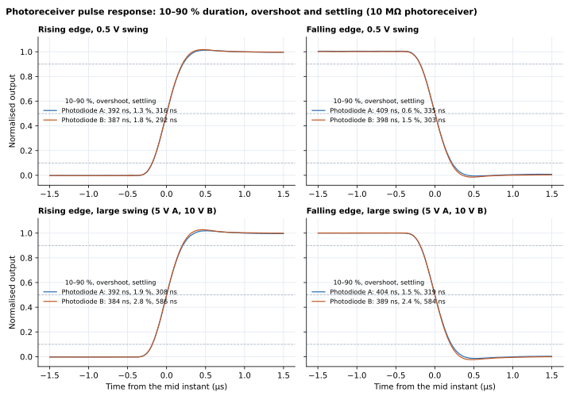

#### TDR terminations: [tdr_terminations.py](examples/tdr_terminations.py)
One probe into open, short, 100 Ω, 50 Ω and waveguide terminations. `measure_edge` measures each reflection between
its own levels, picks the waveguide's far-end edge out of the same trace, and raises `EdgeNotFoundError` for the
matched 50 Ω load, which reflects nothing.

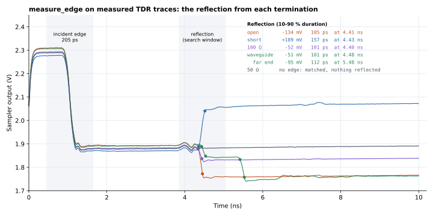

#### Cable skin effect: [cable_skin_effect.py](examples/cable_skin_effect.py)
The open end of 50 m of RG58. The skin-effect tail never flattens, so the high level depends on the `state_levels`
method and the 10–90 % rise time ranges from 43 ns to 84 ns; 20–80 % narrows it but doesn't remove it. Report the
level method and reference with a rise time.

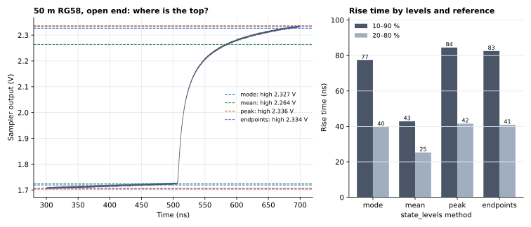

`make examples` rebuilds the figures whose script, `examples/_plot.py` or library code changed (`make -j` runs
them in parallel; set `PYTHON=` to choose the interpreter). Run one script directly with
`PYTHONPATH=src python examples/<script>.py`.

## Installation
### pypi
```bash
pip install pulse_transitions
```

### GitHub Release
```bash
pip install https://github.com/snhobbs/pulse_transitions/archive/refs/tags/<TAGNAME>.zip
```

### From Source
```bash
git clone https://github.com/snhobbs/pulse_transitions/
pip install .
```

## Tests
```bash
make test                                       # or: pytest
PYTHONPATH=src python -m unittest discover -s tests -t . -v
PT_PERF=1 PYTHONPATH=src python -m unittest tests.test_performance -v   # timing tests
PYTHONPATH=src python benchmarks/benchmark.py
```

`tests/test_examples.py` runs every example script as a smoke test, writing the figures to a temporary directory;
it is skipped when matplotlib or scipy isn't installed.

## License

GNU Lesser General Public License, version 2.1 only (`LGPL-2.1-only`); the text is in `LICENSE`.

## Background & Resources
### IEEE Std 181-2003
IEEE Standard on Transitions, Pulses, and Related Waveforms: the definitions this library follows.

### HP Journal
There's an excellent description of the algorithms used by HP [here](https://hparchive.com/Journals/HPJ-1996-12.pdf).

### Control Library
+ [GitHub](https://github.com/python-control/python-control)
+ [Docs](https://python-control.readthedocs.io)
